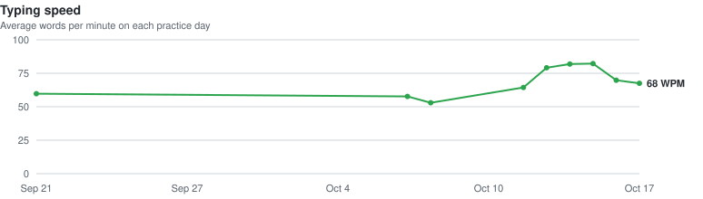

# Typing progress

Touch typing practice on a self-hosted [keybr.com](https://github.com/aradzie/keybr.com).
Each commit to this repo is one practice session.

| Sessions | Lessons | Time practiced | Latest avg speed | Best lesson |
| --- | --- | --- | --- | --- |
| 19 | 470 | 3h 12m | 78.2 WPM | 100.5 WPM |

## Sessions

| Date | Lessons | Time | Avg WPM | Best WPM | Accuracy |
| --- | --- | --- | --- | --- | --- |
| 2026-10-20 21:44 | 2 | 1m | 78.2 | 81.6 | 96.6% |
| 2026-10-20 21:24 | 11 | 7m | 78.1 | 87.5 | 96.9% |
| 2026-10-19 11:51 | 8 | 5m | 78.3 | 85.1 | 96.1% |
| 2026-10-19 08:49 | 27 | 18m | 69.8 | 74.7 | 95.7% |
| 2026-10-18 20:36 | 36 | 19m | 73.7 | 89.4 | 96.7% |
| 2026-10-17 14:11 | 41 | 21m | 67.3 | 81.5 | 97% |
| 2026-10-17 11:40 | 15 | 8m | 67.5 | 80.7 | 97.3% |
| 2026-10-16 15:23 | 1 | 1m | 73.3 | 73.3 | 96.4% |
| 2026-10-16 12:05 | 37 | 18m | 69.7 | 82.7 | 97.2% |
| 2026-10-15 13:25 | 41 | 12m | 83.1 | 97.6 | 97.4% |
| 2026-10-15 09:39 | 54 | 16m | 81.6 | 100.5 | 97.3% |
| 2026-10-14 09:58 | 50 | 15m | 81.9 | 98.5 | 97.7% |
| 2026-10-13 10:05 | 59 | 18m | 79.1 | 91.9 | 97.8% |
| 2026-10-12 17:13 | 3 | 1m | 81.5 | 86.5 | 97.2% |
| 2026-10-12 16:49 | 7 | 2m | 78.9 | 92.9 | 97.5% |
| 2026-10-12 15:00 | 32 | 12m | 60.7 | 85.8 | 97% |
| 2026-10-08 19:41 | 6 | 3m | 53 | 57.4 | 96.6% |
| 2026-10-07 07:52 | 1 | 0m | 57.7 | 57.7 | 94.6% |
| 2026-09-21 12:24 | 39 | 15m | 59.7 | 81.5 | 96.2% |
