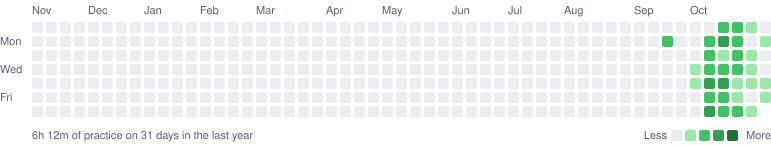
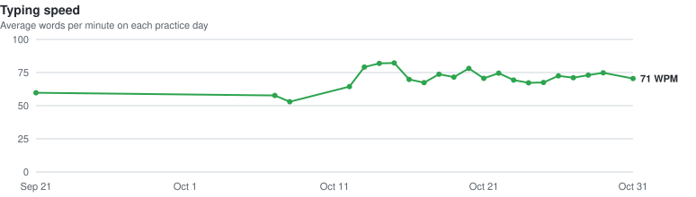

# Typing progress

Touch typing practice on a self-hosted [keybr.com](https://github.com/aradzie/keybr.com).
Each commit to this repo is one practice session.

| Sessions | Lessons | Time practiced | Latest avg speed | Best lesson |
| --- | --- | --- | --- | --- |
| 43 | 744 | 6h 12m | 72.1 WPM | 100.5 WPM |

## Sessions

| Date | Lessons | Time | Avg WPM | Best WPM | Accuracy |
| --- | --- | --- | --- | --- | --- |
| 2026-11-13 22:39 | 1 | 1m | 72.1 | 72.1 | 97.9% |
| 2026-11-12 23:12 | 1 | 1m | 81.9 | 81.9 | 96.9% |
| 2026-11-09 10:08 | 12 | 8m | 73.4 | 76.5 | 95.5% |
| 2026-11-07 08:45 | 5 | 3m | 72.2 | 75.1 | 96.8% |
| 2026-11-05 22:00 | 1 | 1m | 73.7 | 73.7 | 95.7% |
| 2026-11-05 12:36 | 2 | 1m | 74.6 | 80.9 | 97.6% |
| 2026-11-04 23:29 | 4 | 3m | 64.2 | 68.2 | 97.1% |
| 2026-11-03 21:00 | 1 | 1m | 71.2 | 71.2 | 95.7% |
| 2026-11-01 22:10 | 3 | 2m | 68.5 | 72.1 | 96.6% |
| 2026-10-31 14:06 | 28 | 19m | 70.5 | 77.9 | 96.5% |
| 2026-10-30 00:18 | 1 | 1m | 75.3 | 75.3 | 97.8% |
| 2026-10-29 19:19 | 1 | 1m | 74.3 | 74.3 | 97.9% |
| 2026-10-28 13:14 | 14 | 9m | 74.9 | 85.9 | 96% |
| 2026-10-28 12:40 | 13 | 9m | 71.1 | 80.8 | 96.3% |
| 2026-10-27 10:56 | 29 | 19m | 71.1 | 78.8 | 96.2% |
| 2026-10-26 11:35 | 25 | 16m | 72.5 | 78.8 | 96.4% |
| 2026-10-25 22:17 | 6 | 4m | 69.8 | 76.3 | 96.3% |
| 2026-10-25 21:21 | 17 | 12m | 66.7 | 74.7 | 96.6% |
| 2026-10-24 21:48 | 26 | 18m | 67.2 | 76.2 | 96.7% |
| 2026-10-23 12:43 | 24 | 16m | 69.3 | 76.8 | 96.2% |
| 2026-10-22 21:24 | 3 | 2m | 78 | 81.2 | 96.7% |
| 2026-10-22 09:23 | 29 | 18m | 74.2 | 82.8 | 96.3% |
| 2026-10-21 09:13 | 9 | 6m | 67.6 | 75.5 | 95.4% |
| 2026-10-21 08:50 | 19 | 12m | 72.1 | 81.2 | 96.3% |
| 2026-10-20 22:44 | 2 | 1m | 78.2 | 81.6 | 96.6% |
| 2026-10-20 22:24 | 11 | 7m | 78.1 | 87.5 | 96.9% |
| 2026-10-19 12:51 | 8 | 5m | 78.3 | 85.1 | 96.1% |
| 2026-10-19 09:49 | 27 | 18m | 69.8 | 74.7 | 95.7% |
| 2026-10-18 21:36 | 36 | 19m | 73.7 | 89.4 | 96.7% |
| 2026-10-17 15:11 | 41 | 21m | 67.3 | 81.5 | 97% |
| 2026-10-17 12:40 | 15 | 8m | 67.5 | 80.7 | 97.3% |
| 2026-10-16 16:23 | 1 | 1m | 73.3 | 73.3 | 96.4% |
| 2026-10-16 13:05 | 37 | 18m | 69.7 | 82.7 | 97.2% |
| 2026-10-15 14:25 | 41 | 12m | 83.1 | 97.6 | 97.4% |
| 2026-10-15 10:39 | 54 | 16m | 81.6 | 100.5 | 97.3% |
| 2026-10-14 10:58 | 50 | 15m | 81.9 | 98.5 | 97.7% |
| 2026-10-13 11:05 | 59 | 18m | 79.1 | 91.9 | 97.8% |
| 2026-10-12 18:13 | 3 | 1m | 81.5 | 86.5 | 97.2% |
| 2026-10-12 17:49 | 7 | 2m | 78.9 | 92.9 | 97.5% |
| 2026-10-12 16:00 | 32 | 12m | 60.7 | 85.8 | 97% |
| 2026-10-08 20:41 | 6 | 3m | 53 | 57.4 | 96.6% |
| 2026-10-07 08:52 | 1 | 0m | 57.7 | 57.7 | 94.6% |
| 2026-09-21 13:24 | 39 | 15m | 59.7 | 81.5 | 96.2% |
